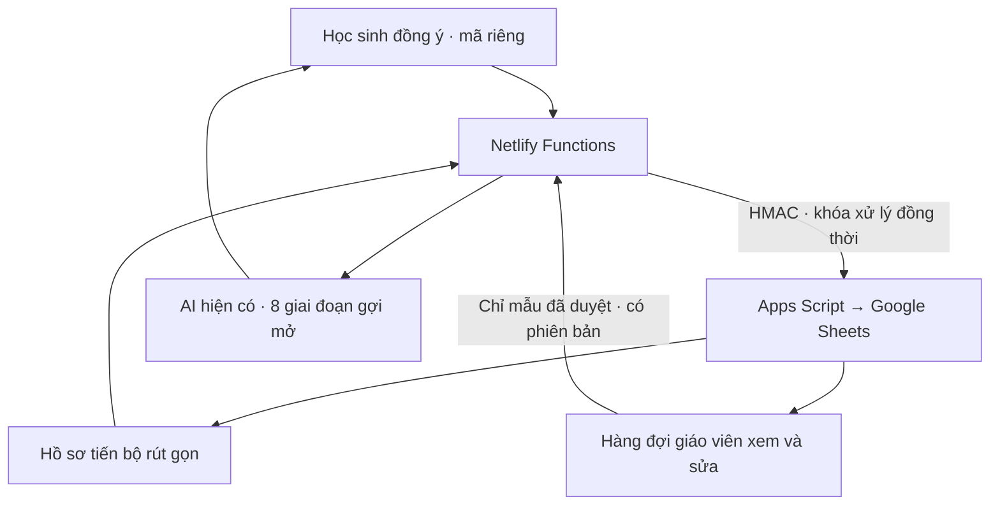

# Sơ đồ dữ liệu V6.5.0

Netlify xác thực mã riêng, đồng ý và đầu vào. Trước khi gọi AI, máy chủ chỉ đọc hồ sơ tóm tắt cùng tối đa ba mẫu phù hợp. Sau khi kiểm tra đánh giá có cấu trúc của AI, Netlify gửi lượt học đã rút gọn vào cổng Apps Script. Một lần ghi nguyên tử cập nhật nhật ký, hồ sơ, phiên và hàng đợi nếu cần.

Khi Google gián đoạn, câu hỏi gợi mở vẫn được trả lại. Nếu việc ghi đã được thử nhưng chưa nhận xác nhận, máy chủ trả phiếu ký để gửi lại. Giáo viên duyệt mẫu khái quát hóa ở một luồng riêng; câu trả lời học sinh không trực tiếp sửa hướng dẫn chung.
